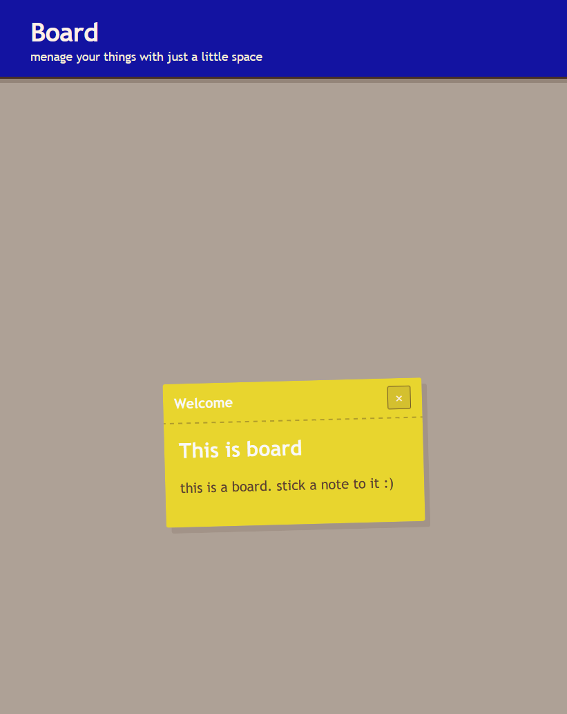

## Board 

It is a board you stick notes to it.
Nothing more nothing less.

# Why this project ?

To learn to code and to have fun while coding in CSS.

* usually JavaScript is the hardest for me *

# Functions :

- Clock
- Notes
- Daily space pictures

* Little basic. I know *

# How it looks

#Languages used 

- CSS
- JavaScript
- HTML
- Shell
- YAML
- JSON
