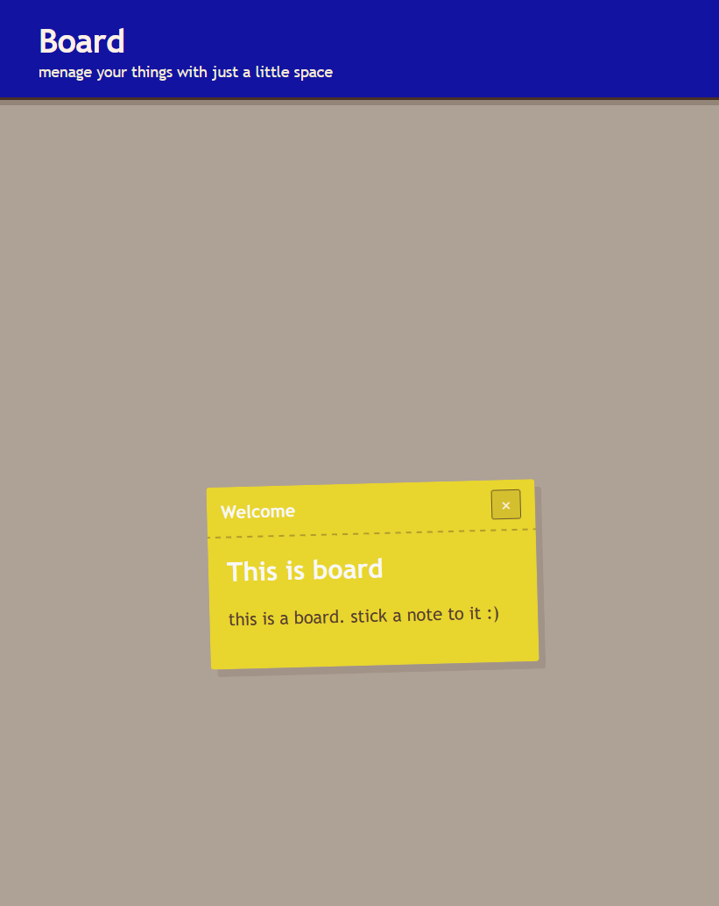

## Board 

Board you can use to organise and manage things.

[try it !](https://hamarisun.github.io/star/)

# How it looks

# Why this project ?

To learn to code and to have fun while coding in CSS.

* learning how to use api and vite for the first time, and continuing CSS and  JavaScript *

* usually JavaScript is the hardest for me *

# Functions :

- Clock
- Notes
- Daily space picture ( not available right now, technical issues :[ )

# How to use this 

open the website click on the +sicky note button and add anything you want.

... and place it where ever you would like to!

# Languages used 

- CSS
- JavaScript
- HTML
- Shell
- YAML
- JSON
